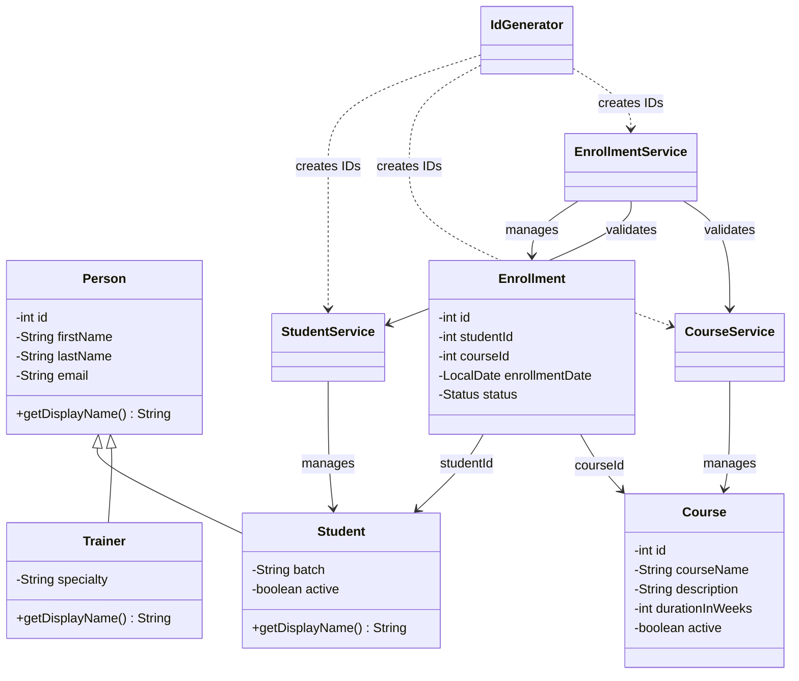

# LearnTrack — Student & Course Management System

LearnTrack is a console-based Student & Course Management System built with Core Java. It demonstrates classes, encapsulation, inheritance, polymorphism, constructors, static members, `ArrayList`, menu-driven control flow, and basic exception handling.

## Features

- Add, list, search, update, activate, and deactivate students.
- Add, list, search, update, activate, and deactivate courses.
- Enroll active students in active courses.
- View all enrollments or enrollments for a student.
- Mark enrollments as `COMPLETED` or `CANCELLED`.
- Validate user input and display friendly errors for invalid IDs and options.
- Keep data in memory using `ArrayList` (data resets when the program exits).

## Requirements

- JDK 17 or later (the code uses switch expressions / arrow switch labels).
- Terminal, command prompt, or a Java IDE.

## Compile and run

Run these commands from the repository root.

### Windows PowerShell

```powershell
New-Item -ItemType Directory -Force out
javac -d out (Get-ChildItem -Recurse src -Filter *.java | ForEach-Object { $_.FullName })
java -cp out com.airtribe.learntrack.ui.Main
```

### macOS / Linux

```bash
mkdir -p out
javac -d out $(find src -name "*.java")
java -cp out com.airtribe.learntrack.ui.Main
```

To verify the installed Java tools:

```bash
java -version
javac -version
```

## Package structure

```text
src/com/airtribe/learntrack/
├── entity/      # Person, Student, Trainer, Course, Enrollment
├── service/     # Business logic and in-memory collections
├── exception/   # Custom checked exceptions
├── util/        # Static ID generator
└── ui/          # Menu-driven console application
```

## Class diagram



## Design choices

- **ArrayList:** the number of students, courses, and enrollments changes while the program runs. `ArrayList` grows dynamically, unlike a fixed-size array.
- **Static ID generator:** ID counters belong to the application-wide utility class, so services can request the next ID without creating an `IdGenerator` object.
- **Inheritance:** `Student` and `Trainer` extend `Person` to reuse common identity fields and behavior.
- **Polymorphism:** `Student` and `Trainer` override `getDisplayName()`.
- **Separation of concerns:** entities hold data, services contain business rules, and `Main` handles console input/output.

## Limitations

This is an educational in-memory application. Data is not persisted after exit, authentication is not included, and it is intended for a single console user.

## Suggested GitHub submission workflow

1. Create a **public** GitHub repository named `LearnTrack`.
2. Add these files and commit them to a working branch.
3. Push the branch to GitHub.
4. Open a pull request to the branch specified by your cohort/instructor.
5. Submit both the repository URL and the pull request URL.

Example commit:

```bash
git add .
git commit -m "Build LearnTrack Core Java management system"
git push -u origin feature/learntrack-core-java
```

Do not submit a fabricated PR URL: create the repository and PR in your GitHub account first.


## Submission

This project was developed using Core Java to demonstrate object-oriented programming, collections, exception handling, and menu-driven console applications.

### Technologies
- Java 21
- Eclipse IDE
- Git and GitHub
